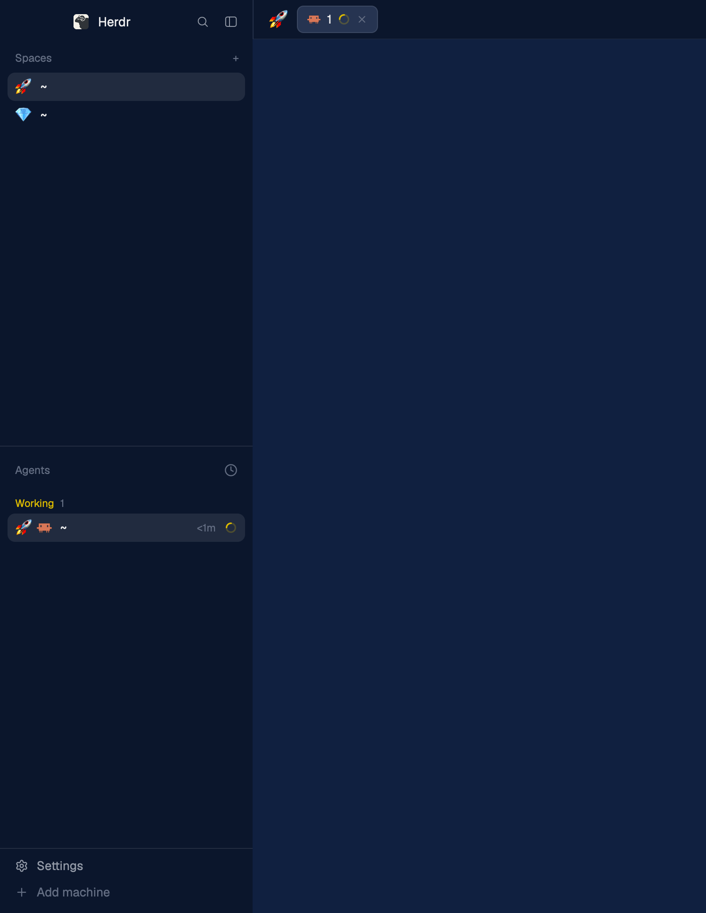

# Emoji spaces

Herdr's main window, with an emoji and a theme for each space. Pick an emoji from the space's right-click menu or by clicking its letter tile. The emoji replaces the tile in the spaces sidebar. It also appears before the active space's tabs, and before each agent's logo in the agents list. Pick a theme from the same menu, from Herdr's themes or any installed Ghostty theme. The whole window switches to it while that space shows. Spaces without an emoji or a theme look the same as in Herdr's `main` layout.

## What you see

The window is Herdr's `main` layout, unchanged except for three blocks and the menus they open. The sidebar is on the left with spaces above agents, and the tab bar is across the top.

- **Spaces sidebar.** A space with an emoji shows it in place of the 18 px colored letter tile, at text size 14 on no background. Other spaces keep the letter tile. In the narrow rail (sidebar under 160 px), the emoji replaces the space's number.
- **Tab bar.** If the active space has an emoji, it sits at the far left, before the first tab. It's 29 px tall with 6 px side padding and 7 px corners, at text size 16. Without an emoji, nothing is drawn there.
- **Agents list.** Each agent row shows its space's emoji, then the agent's program logo, then its name. The emoji is text size 14, with 4 px between it and the logo. In the "Grouped by space" view, each space header starts with the emoji at text size 12. In the narrow rail, the emoji replaces the agent's number.
- **Picker popup.** 296 x 340 px, `popover` background, 10 px padding, 8 px gaps, text size 12. From the top:
  - A header row reading "Emoji for <space name>" in `muted`, truncated. A "Remove" button in `dim` sits on the right, shown only when the space has an emoji.
  - A text field, 28 px tall, 6 px corners, an `input` border, `background` fill, placeholder "Or type or paste one, then Enter".
  - Six labeled groups of 12 emoji each: Work, Places, Things, Nature, Creatures, Food. Labels are text size 11 in `dim`. Each cell is 22 x 22 px, 5 px corners, text size 16, with 1 px gaps, wrapping. The current emoji's cell has a `selected` background.
- **Theme picker popup.** 340 x 470 px, with the same frame, header and text field as the emoji picker. The header reads "Theme for <space name>", with a "Reset" button when the space has a theme. The placeholder is "Search themes". Below it:
  - A 340 px scrolling list of every matching theme, with a scrollbar. Herdr's themes come first under a "Herdr" header, then Ghostty's under a "Ghostty" header. Each 26 px header shows the source, its count and a 1 px `border` line to the right, at text size 11 in `dim`. Herdr's themes show at once. The Ghostty header reads "loading…" until its themes arrive, and a header whose section matches nothing is hidden. Each 30 px row has a 74 x 20 px swatch, with "Aa" in the theme's foreground and six 5 px dots for `ansi1` to `ansi6`, on the theme's background. The theme's name follows. The space's current theme has a `selected` row.
  - A footer in `dim` at text size 11 with the total, such as "389 dark themes".

## How it behaves

- Clicking a space's tile or emoji in the sidebar opens the picker for that space, at the pointer. The click doesn't select or drag the space. Clicking the rest of the row still selects it, and dragging still reorders.
- Right-clicking a space opens Herdr's space menu with one extra item, "Set emoji", right after "Rename", with a smiley icon. Choosing it opens the picker for that space.
- Clicking the emoji in the tab bar opens the picker for the active space.
- In the picker, clicking a cell sets that emoji and closes the popup. Typing in the field and pressing Enter sets whatever was typed, trimmed, so any emoji or short text works. "Remove" clears the emoji and closes the popup. Esc closes it without a change. The field has the keyboard when the popup opens.
- Opened with no space in its props, the picker acts on the focused space.
- Emoji are kept per space ID, so they survive renames, restarts and layout switches. Renaming a space never touches its emoji, and setting an emoji never renames the space. An unnamed space keeps following its folder.
- When a space closes, its emoji is dropped.
- Agent status (working, blocked, done, idle) looks exactly as in Herdr's agents list. The emoji doesn't change with status.
- Right-clicking a space also shows "Set theme", with a 🎨 icon, after "Set emoji". "Set emoji" uses the space's own emoji as its icon, or 😀 until it has one. It opens the theme picker for that space.
- The theme picker lists Herdr's themes first, then Ghostty's, filtered to the system's current appearance. In dark mode it lists only dark themes. Typing filters by name, and Enter picks the first match. Clicking a row picks it. The window switches at once if that space is showing.
- Switching spaces switches the window's theme to that space's theme. A space without one gets the normal theme: whatever showed before any space had a theme. Changing the theme with Herdr's own theme menu, while in a space without a theme, makes that the new normal theme.
- "Reset" clears the space's theme and goes back to the normal theme.

## Built from

- `layouts/main-emoji.json`: a `layout.clone` of `main`. Three `content.mod` values change: `spaces` to `spaces-emoji`, `agents` to `agents-emoji`, `tabs` to `tabs-emoji`. Everything else, including `workspace-chrome`, `files`, `changes`, `pane` and `workspace-status`, is Herdr's.
- `mods/space-emoji/`: the picker, written from scratch. It opens as `openOverlay({ mod: "space-emoji", kind: "popup", width: 296, height: 340, props: { space } })`. It reads and writes the shared key `space.emoji`, an object of space ID to emoji string, through `shared` and `setShared`. It closes itself with `closeOverlay(props().overlay)`. The text field is `InputState` and `Input` from `gpui-base`, with a `submit` handler.
- `mods/spaces-emoji/`: a `mod.clone` of `spaces`. It adds an `avatar()` method that draws the emoji or the original letter tile. The avatar has `on_mouse_down("left")` and `on_mouse_up("left")` handlers that call `cx.stop_propagation()`, and the mouse-up opens the picker. It also opens `menu-emoji` in place of `menu` on right-click. Its `follow()`, called from `render()`, applies themes: when the active space changes, it runs `app.theme` with that space's entry in shared `space.themes`, else with shared `space.themes.base`. It sets `space.themes.base` to the current theme on its first run, and again when leaving a space without a theme. The current theme name is `settings().theme`, or its `dark` or `light` half when it's a pair, by `settings().dark`.
- `mods/menu-emoji/`: a `mod.clone` of `menu`. In the `space` items it adds `["Set emoji", "emoji", { space: tg.id }]` and `["Set theme", "theme", { space: tg.id }]` after "Rename". Choosing one calls `openOverlay` for its picker in place of `run()`. Their icons are emoji at text size 12 in a 14 px box, where the other items draw an SVG.
- `mods/tabs-emoji/`: a `mod.clone` of `tabs`. It adds the emoji block before the `tab-scroll` row, with `on_mouse_down("left")` stopped so the bar doesn't treat it as a tab press.
- `mods/agents-emoji/`: a `mod.clone` of `agents`. It reads `space.emoji` once per render, puts the emoji before the program icon in each row with `.mr(-5)` to tighten the 9 px row gap, adds `space` to each group, and draws the emoji in space headers.
- `mods/space-theme/`: the theme picker, written from scratch. It opens as `openOverlay({ mod: "space-theme", kind: "popup", width: 340, height: 470, props: { space } })`. Herdr's themes come from `themes()`, skipping names that start with `ghostty-`. Ghostty themes come from `/Applications/Ghostty.app/Contents/Resources/ghostty/themes` and `~/.config/ghostty/themes`, read in one `exec("sh", ["-c", ...])` that prints each file after an `@@<name>` line. Each Ghostty file maps `palette = 0=` to `15=` to `ansi`, `background`, `foreground`, `cursor-color` to `cursor`, and `selection-background` to `selection`. A file missing any of the 16 colors, the background or the foreground is skipped. A theme counts as light when its background's luminance is over 0.5. The parsed list is cached in `data/space-theme/ghostty.json`, keyed by the folders' paths and modification times from `stat`, so later opens skip the parsing. The list is a `v_virtual_list` with 30 px theme rows and 26 px headers, sized by an array, paired with `Scrollbar.vertical`, and clicks come through `on_item_click` with the theme's file name as the key. Picking a Ghostty theme writes `themes/ghostty-<slug>.json` with `writeTextFile`, waits until `themes()` lists it, then saves the name in `space.themes`.
- Programs and network: the emoji picker, tab bar, and agents list run nothing and fetch nothing. The theme picker runs `sh` and `cat` to read Ghostty's theme folders, and `sleep` while Herdr picks up a new theme file. It writes only `themes/ghostty-*.json`. `spaces-emoji` keeps Herdr's own `git status`, `git rev-parse`, `hc machine ls` and `watchFolder` calls for branch info. `menu-emoji` keeps Herdr's `git rev-parse` calls for the worktree items.

## Watch out

- Herdr's own mods and layouts are read-only. An edited copy is moved to `<name>-edited` on the next start. Use `mod.clone` and `layout.clone`, then edit the clones.
- The picker's emoji grid must be `flex_none`, not `flex_1().min_h(0)`. `mod.open` sizes the popup to its content, and a flexible grid then shrinks to zero height.
- The space row selects on mouse-up and drags between mouse-down and mouse-up. The avatar has to stop both events, or a tile click also selects the space.
- Never drop `space.emoji` or `space.themes` entries for spaces missing from `spaces()`. While a layout loads, `spaces()` can be partial, and pruning then wipes live spaces' picks. Entries for closed spaces are harmless.
- `app.theme {name}` sets only the half of the layout's theme that matches the theme's lightness. A light theme picked in dark mode doesn't show, which is why the picker lists only themes for the current appearance.
- Theme picks go to `layouts/.state/`, not the layout file, so following spaces never edits `main-emoji.json`.
- A new file in `themes/` takes a moment to show in `themes()`. Calling `app.theme` before then fails.
- Draw the theme list with a virtual list. Hundreds of rows with swatches, rebuilt on every keystroke, make typing lag. Rows inside a virtual list can't have click handlers, so use `on_item_click`.
- `herdr-app check` crashes on any mod with a virtual list, Herdr's own `changes` mod included. Test `space-theme` in the running app with `herdr-app do mod.open --name space-theme`.
- Run `app.theme` only when the active space changes, not on every render, or it fights the person's own theme picks.
- `props()` is null under `herdr-app check`, so guard it with `props() ?? {}`.
- Herdr doesn't hot-reload a running mod reached through a symlinked folder. If you keep the mods elsewhere and link them in, switch layouts away and back after each edit.
- Clones don't pick up Herdr's later changes to `main`, `spaces`, `agents`, `tabs` or `menu`.

## Done when

- `herdr-app check` passes for all mods but `space-theme`, which the check can't load.
- `herdr-app do layout.switch --name main-emoji` shows the window, and `herdr-app status` lists no errors.
- Clicking a space's letter tile opens the picker. Clicking an emoji closes it, and the sidebar, the tab bar and that space's agent rows all show the emoji.
- Right-clicking a space shows "Set emoji" under "Rename", and it opens the picker for that space.
- Typing an emoji in the field and pressing Enter sets it.
- "Remove" brings back the letter tile and clears the emoji in the tab bar and the agents list.
- Renaming the space keeps its emoji, and renaming it to "" brings back Herdr's name.
- `herdr-app do mod.open --name space-emoji` opens the picker for the focused space with the full grid showing.
- "Set theme" on a space opens the theme picker. Once loaded, it lists Herdr's and Ghostty's themes for the current appearance.
- Picking a Ghostty theme for the shown space switches the window to it, and `themes/ghostty-<slug>.json` exists.
- Switching to a space without a theme brings back the normal theme. Switching back brings the space's theme again.
- "Reset" brings back the normal theme for that space.
